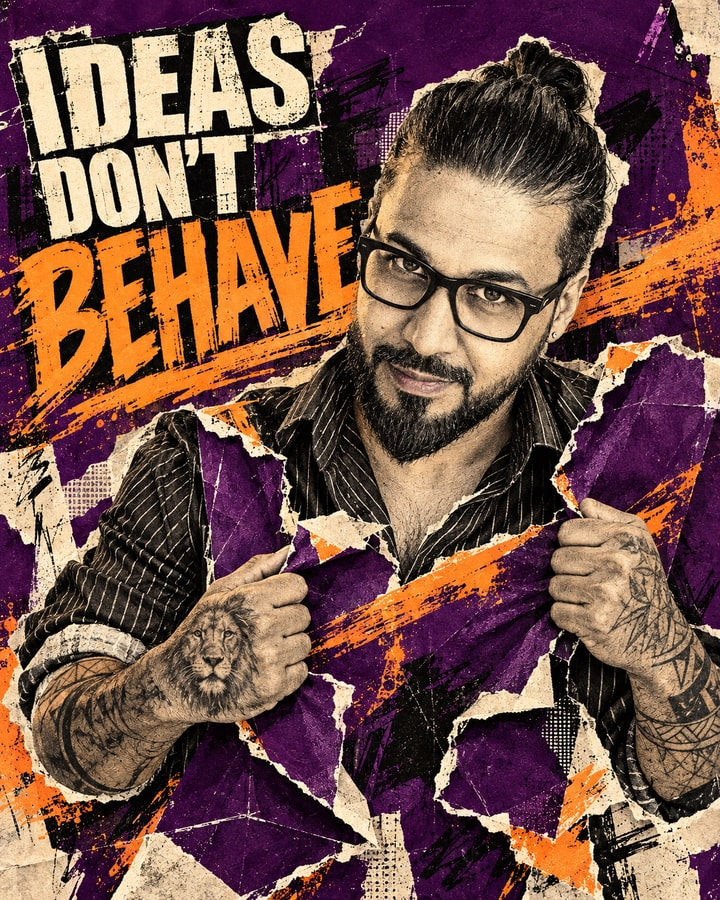
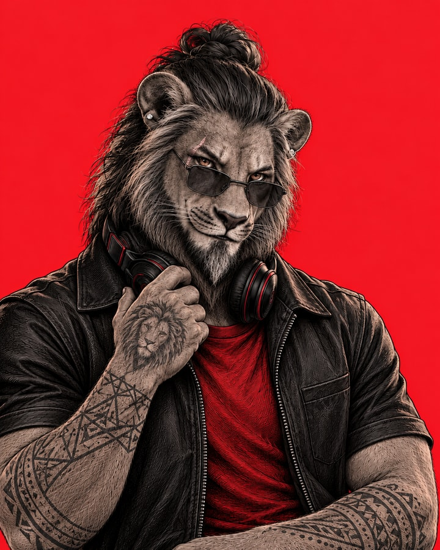
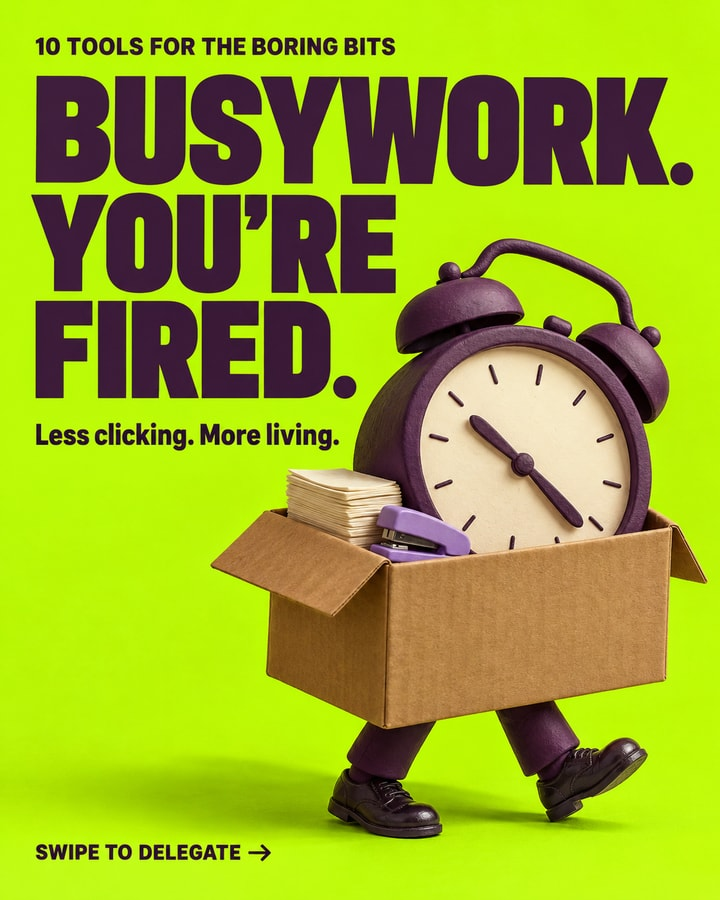
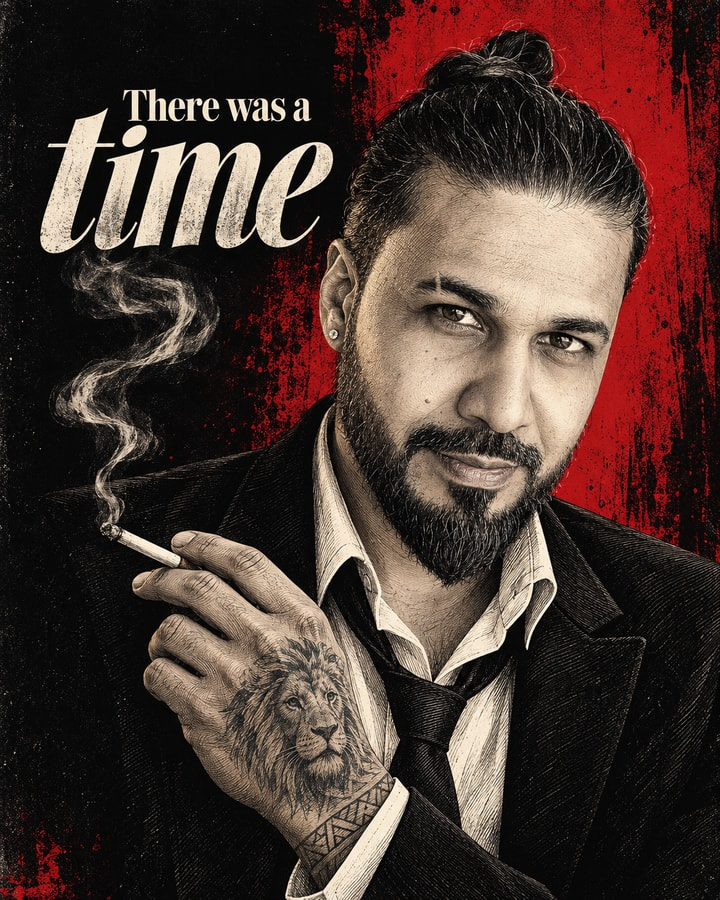
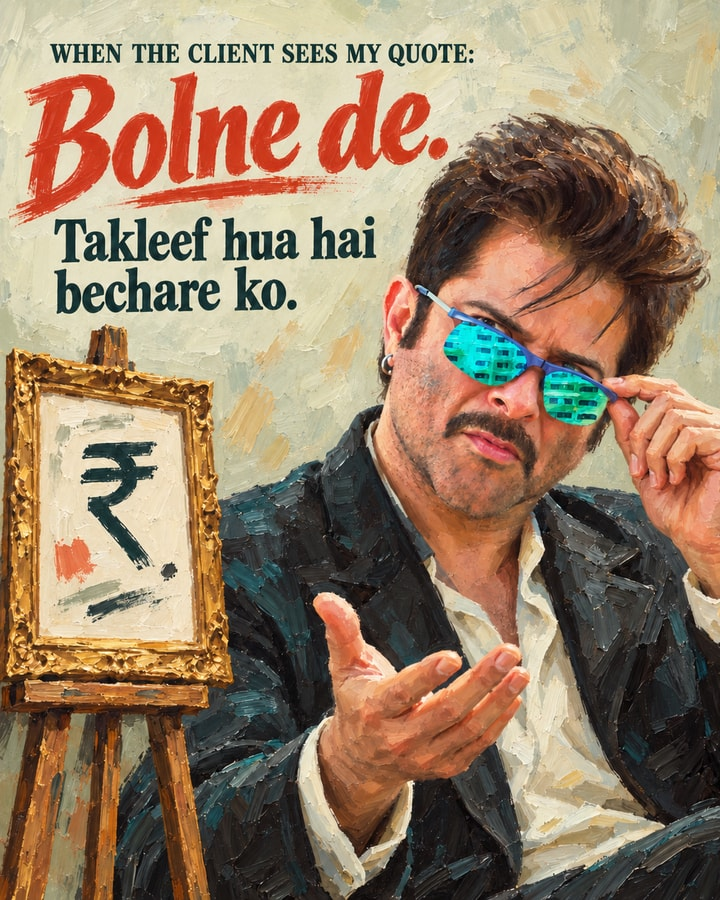
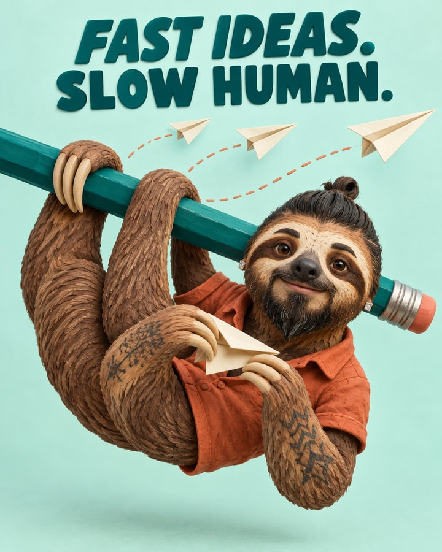

  

<h1 align="center">Turn AI Slop Into Work Worth Paying For.</h1>

<strong>Think like a designer. Execute like an artist.</strong>

  <a href="docs/getting-started.md"><strong>Start creating →</strong></a> &nbsp; / &nbsp;
  <a href="docs/gallery.md">See the work</a> &nbsp; / &nbsp;
  <a href="docs/creative-system.md">Inside the process</a> &nbsp; / &nbsp;
  <a href="docs/automation.md">Put it to work daily</a>

---

**BeyondArtist is an AI design skill built to help freelancers, content creators and digital marketers use AI to create original, sellable work and viral content.** It guides your agent through a designer’s thinking—understand the audience, research the category, find the creative angle, and choose purposeful typography, color and structure—then gives the artist room to create something distinctive. Turn your ideas into client-ready designs and content that stands out.

## The work comes first

<table>
<tr>
<td width="50%"></td>
<td width="50%"></td>
</tr>
<tr>
<td width="50%"></td>
<td width="50%"></td>
</tr>
<tr>
<td width="50%"></td>
<td width="50%"></td>
</tr>
</table>

**[Explore all 16 sample artworks →](docs/gallery.md)** · These are selected design examples. The people, characters, colors and claims pictured here do not become your defaults.

## AI can make images. Give it a reason to make something worth seeing.

BeyondArtist is a complete creative design workflow for AI agents. It brings together a **designer**, an **artist**, source-linked **Design Memory**, personal/project memory and an actual-art quality check. Start with an idea, a client brief, a photograph, a phrase or a reference. The agent shapes the message, finds the creative angle, develops the visual language, creates the work and checks the result.

**Control AI. Direct its taste. Create beyond the prompt.**

Built for YouTube thumbnails, Instagram carousels, freelance client work, campaign artwork, posters, characters, product imagery, covers and visual brand projects. Each brief gets its own concept, palette, expression and hierarchy.

> **Think like a designer. Create like an artist. Study attention like a strategist.**

## Why BeyondArtist exists

Repeated layouts. The same pasted face. Loud color without a concept. Decorative typography. Different subjects that somehow all look the same. These are design problems that another longer image prompt often leaves unresolved.

BeyondArtist gives the agent a working creative process. It studies the audience and visual environment, retrieves useful principles, develops distinct concepts and gives the artist room to surprise. Then it checks whether the idea, medium, expression, type and hierarchy actually appear in the finished pixels.

| The problem | The creative response |
|---|---|
| Every result has the same flavor | Choose the concept, art form and palette for this brief |
| A photograph is pasted into a template | Art-direct identity, expression, styling and light when recreation serves the work |
| The hook and artwork tell different stories | Develop copy and imagery together, with a deliberate reading order |
| References are copied or barely studied | Transfer gesture, craft, emotion, material and structure into an original interpretation |
| A carousel is a stack of unrelated images | Build its hook, progression, rhythm and payoff as one experience |
| The agent forgets what the client said | Retrieve tagged personal and project records before asking again |

## Built for attention. Ready for real creative work.

The designer studies what this audience sees, what inspected examples repeat and which useful angle could earn attention. The artist turns that angle into a distinctive piece of work. Short copy, expressive craft, small-screen clarity and a truthful curiosity gap support content people want to click, swipe, save or share.

Use it to develop a creator’s visual identity, deliver a coherent client carousel, art-direct a product campaign or build a freelance portfolio. It can support sellable creative work; the quality still depends on the brief, available tools, review and the rights attached to the final assets.

Built from Beyond Tahir’s creative experience and a developed design library, BeyondArtist puts viral-content thinking, artistic execution and reusable client context into one workflow. Save feedback from each job and make the next piece sharper.

## One creative team. Nine connected steps.

| Step | What happens |
|---|---|
| **01 — Understand** | Retrieve relevant user context; ask only the missing consequential questions |
| **02 — Classify & retrieve** | Separate platform, format, content category and mood; search Design Memory |
| **03 — Research** | Inspect the category and Pinterest; distinguish observations from performance hypotheses |
| **04 — Design the idea** | Develop the angle, exact copy, type hierarchy, palette roles and composition or sequence |
| **05 — Hand off** | Give the artist constraints, evidence, source lessons and visible acceptance checks |
| **06 — Explore as an artist** | Compare three meaningful concepts for substantial work; refine medium, emotion and craft |
| **07 — Create** | Use the best available image/design tools and finish exact text where needed |
| **08 — Inspect together** | Review actual artwork at full and realistic viewing size; repair concrete weaknesses |
| **09 — Deliver & learn** | Return finished files, concise reasoning and scoped memory updates |

The artist can improve the designer’s plan. Both own hierarchy. An open brief gets the strongest finished direction; a complete detailed brief gets the requested direction plus an artist alternative unless you request one output. A small correction stays a small correction.

**[Read how concepts, palettes, typography and artist hierarchy are chosen →](docs/creative-system.md)**

## Memory that grows with you

| Memory layer | What it contains |
|---|---|
| **Shared Design Memory** | Reusable instructions, source-linked design studies, palette relationships, typography, hierarchy and thumbnail lessons |
| **Your personal memory** | Your supplied identity references, scoped brand rules, preferences and approved/rejected directions |
| **Your project memory** | This job’s brief, source observations, concept decisions, assets, revisions, deliverables and actual feedback |

The shared library includes **95 foundation records, 700 Pinterest preview studies, 54 style-panel studies, seven seed studies and 100 engagement-qualified thumbnail references**, plus workflow guidance. These counts describe different kinds of evidence; they are not a claim of that many independent designs or proven viral outcomes.

Retrieval uses local Python helpers and canonical Markdown/JSON. It needs no vector database or API key. Private records live outside the installed skill, defaulting to <code>~/.beyondartist/memory</code>, and evolve during skill use. With no browser, the agent can use saved lessons and your context while clearly labeling offline research.

**[Memory, consistency and privacy →](docs/memory.md)**

## Start with a normal brief

~~~text
Use BeyondArtist. Create an Instagram carousel explaining my service to small
business owners. Keep the copy short. I want warm humor and an artistic visual
system. Ask only for information you still need, then handle the design choices.
~~~

You can also give a detailed structure, reference an approved design or request a bounded edit. You do not need to choose a font, palette or rendering vocabulary first.

**[Copy-ready examples for thumbnails, carousels, freelance work and posts →](examples/briefs.md)**

## Choose your agent

| Surface | Starting route |
|---|---|
| **Codex** | Install the full folder under <code>.agents/skills</code>; invoke <code>$beyondartist</code> |
| **Claude Code** | Install under <code>.claude/skills</code>; invoke <code>/beyondartist</code> |
| **Claude Cowork** | Upload the skill ZIP through Customize → Skills; start a fresh session |
| **ChatGPT Work** | Use an accessible local skill in the desktop app or an enabled plugin route; invoke <code>@beyondartist</code> |
| **Gemini Apps / CLI** | Upload through Gemini Skills, or link the folder using Gemini CLI |
| **Hermes Agent** | Install the complete skill; invoke <code>/beyondartist</code> |
| **Dots / Grok Bot** | Use the documented skill-access or saved-workflow route and verify accessible tools |

**[Installation and current host-specific instructions →](docs/getting-started.md)** · **[Daily automation recipes →](docs/automation.md)**

The host supplies image generation, browsing, vision, file access and scheduling. BeyondArtist supplies creative judgment and the workflow. A host without rendering tools gets a labeled production specification; a finished image is delivered only when it was actually created. Documentation-based compatibility is separate from runtime testing.

## What ships

~~~text
beyondartist/
├── README.md                 The story and selected work
├── plugin.json               Portable plugin manifest
├── skills/beyondartist/      Complete installable skill and shared Design Memory
├── assets/                   Approved identity and showcase images only
├── docs/                     Process, setup, memory, automation and gallery
├── examples/                 Synthetic starter briefs and recurring-job prompts
└── scripts/                  Local installation, packaging and release checks
~~~

The workflow, code and reusable written guidance are MIT licensed. Showcase artwork and BeyondArtist identity are display examples with separate terms in [ASSET-LICENSE.md](ASSET-LICENSE.md). Private photographs, personal prompts, transcripts and runtime profiles are excluded. Read [contribution guidance](CONTRIBUTING.md) before adding reference knowledge.

<strong>Think deeply. Create boldly. Make the right parts matter.</strong> BeyondArtist — by Beyond Tahir

