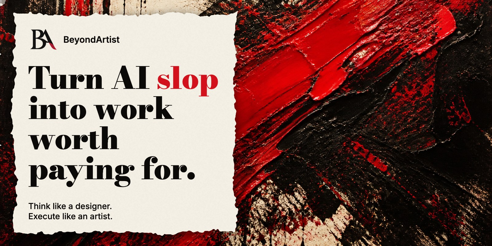
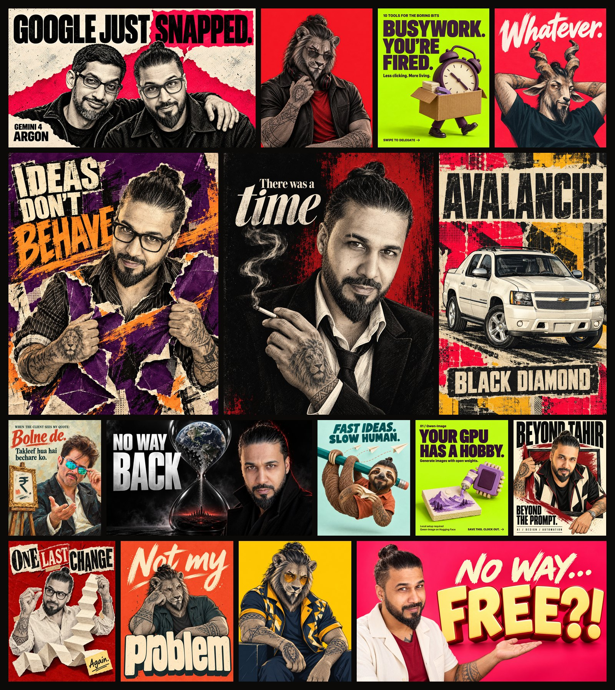
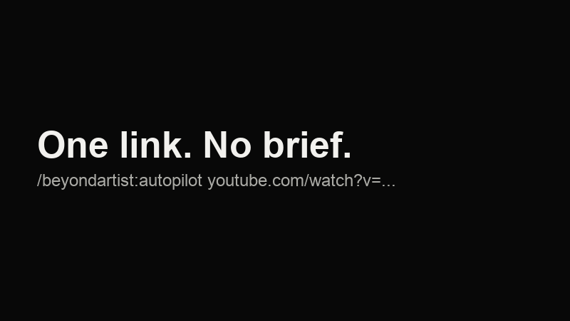
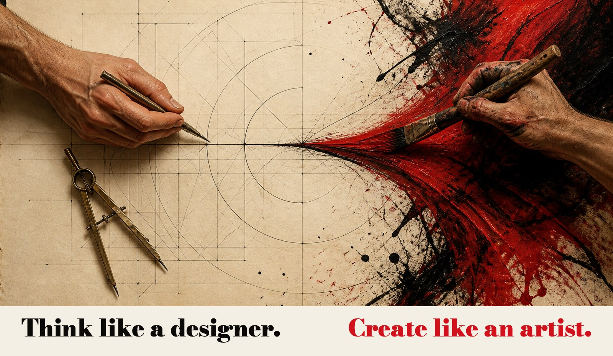

<a href="docs/getting-started.md"><picture><source srcset="assets/readme/hero.webp" type="image/webp"></picture></a>

<h1 align="center">Your AI can make images. This makes it care how they look.</h1>

<strong>A free design skill for freelancers, creators and marketers.</strong> Think like a designer. Execute like an artist.

  <a href="#install-in-30-seconds"><strong>Install</strong></a> &nbsp;·&nbsp;
  <a href="#autopilot">Autopilot</a> &nbsp;·&nbsp;
  <a href="docs/gallery.md">Gallery</a> &nbsp;·&nbsp;
  <a href="docs/creative-system.md">The process</a> &nbsp;·&nbsp;
  <a href="docs/automation.md">Daily automation</a>

## Not one template. Sixteen different answers.

Same skill, sixteen briefs. Nothing here shares a palette, a layout or a trick, because each piece started from its own idea. **[See them full size →](docs/gallery.md)**

Selected design examples. The people, characters, colors and claims pictured do not become your defaults. See [asset terms](ASSET-LICENSE.md).

## Install in 30 seconds

**Claude Code.** Run these inside Claude Code, then restart it:

~~~text
/plugin marketplace add beyondtahir/beyondartist
/plugin install beyondartist@beyondartist
~~~

**Using something else?** Codex, Claude Cowork, ChatGPT, Gemini, Hermes and others each have a route in the **[setup guide →](docs/getting-started.md)**

Then just talk to it:

~~~text
Use BeyondArtist. Make a carousel explaining my service to small business owners.
Keep the copy short. Warm humor. Handle the design choices.
~~~

You don't need to know fonts, palettes or prompt tricks. No image model? **[It still works →](docs/no-image-model.md)**

## Autopilot

> **One link. No brief. Finished designs.**

~~~text
/beyondartist:autopilot https://www.youtube.com/watch?v=VIDEO_ID
~~~

| | What it does for you |
|---|---|
| **Reads the job** | Your title, description, chapters and current thumbnail |
| **Knows your taste** | What you approved and rejected, kept privately on your machine |
| **Feed Test** | Puts each design among real competitor thumbnails at phone, desktop and sidebar size |
| **Quality Gate** | Measures the finished pixels: exact words, phone-size contrast, overlay collisions, clutter and repeats of your past work |
| **Real type** | Sets exact text in real fonts, including shaped Urdu, Arabic, Persian and Hindi |
| **Delivery pack** | Upload-ready file, master, phone preview and editable HTML |

It never uploads anything, and it never promises clicks. The Gate measures the file, not the future. **[How Autopilot works →](docs/autopilot.md)**

## Two minds. One mark.

Most AI design jumps from your sentence straight to a picture. BeyondArtist puts two roles in between. The **designer** finds the message, the audience and what the category keeps repeating. The **artist** turns that into something nobody expected. Either can overrule the other, and both must approve the actual pixels.

<strong>See the nine steps</strong>

 

| Step | What happens |
|---|---|
| **01 Understand** | Retrieve your context; ask only what's truly missing |
| **02 Classify and retrieve** | Separate platform, format, category and mood; search Design Memory |
| **03 Research** | Inspect the category and Pinterest; keep observation apart from guesswork |
| **04 Design the idea** | Angle, exact copy, type hierarchy, palette roles and composition |
| **05 Hand off** | Give the artist constraints, evidence and visible acceptance checks |
| **06 Explore as an artist** | Compare three meaningfully different concepts |
| **07 Create** | Use the best available image and design tools; finish exact text |
| **08 Inspect together** | Review the real artwork at full and viewing size; repair weaknesses |
| **09 Deliver and learn** | Return finished files, concise reasoning and memory updates |

An open brief gets the strongest direction. A detailed brief gets what you asked for, plus an artist's alternative unless you want just one. A small correction stays a small correction. **[Go deeper →](docs/creative-system.md)**

## It remembers. Slop doesn't.

| Memory | What it holds |
|---|---|
| **Design Memory** (shared) | 95 foundation records, 700 Pinterest studies, 54 style panels, 7 seed studies and 100 engagement-qualified thumbnail references, plus workflow guidance |
| **Your memory** (private) | Your likeness references, brand rules, preferences and approved or rejected directions |
| **Project memory** (private) | Each job's brief, decisions, revisions, deliverables and real feedback |

Runs locally with Python. No vector database and no API key. Your records stay in <code>~/.beyondartist/memory</code>, outside the skill. The library counts describe different kinds of evidence, not proof of viral results. **[Memory and privacy →](docs/memory.md)**

## Works where you work

| Host | Start with |
|---|---|
| **Claude Code** | The plugin above, then <code>/beyondartist:autopilot</code> or <code>/beyondartist:beyondartist</code> |
| **Claude Cowork** | Upload the skill ZIP in Customize → Skills |
| **Codex** | Install under <code>.agents/skills</code>; invoke <code>$beyondartist</code> |
| **ChatGPT Work** | A local skill or enabled plugin; invoke <code>@beyondartist</code> |
| **Gemini** | Upload through Gemini Skills, or link the folder in the CLI |
| **Hermes Agent** | Install the complete skill; invoke <code>/beyondartist</code> |
| **Dots / Grok Bot** | The documented skill-access or saved-workflow route |

**It uses the best model your assistant has**, and it hardcodes none: BeyondArtist supplies the judgment and the workflow, and your host supplies the image generation, browsing and vision. **[Which model? →](docs/autopilot.md#which-ai-model-does-it-use)** Quality still depends on your brief, your tools, your review and the rights to your final assets. Routes come from each host's documentation; runtime results can differ. **[Full instructions →](docs/getting-started.md)** · **[Daily automation →](docs/automation.md)**

## Made something with it?

**[Show us →](https://github.com/beyondtahir/beyondartist/issues/new?template=share-your-work.yml)** · **[Hit a problem? →](https://github.com/beyondtahir/beyondartist/issues/new?template=install-problem.yml)** · **[Contribute →](CONTRIBUTING.md)** · **[What changed →](CHANGELOG.md)**

## Made by

<table>
<tr>
<td align="center" width="33%"><a href="https://github.com/beyondtahir"> <strong>Beyond Tahir</strong></a> Creator and project lead: creative direction, design experience and shared learning</td>
<td align="center" width="33%"><a href="https://github.com/codex"> <strong>Codex</strong></a> OpenAI's coding agent: engineering, documentation, packaging and validation</td>
<td align="center" width="33%"><a href="https://github.com/claude"> <strong>Claude</strong></a> Anthropic's coding agent: Autopilot, Quality Gate, Claude plugin and this page</td>
</tr>
</table>

The workflow, code and written guidance are [MIT licensed](LICENSE). Showcase art and BeyondArtist identity have [separate terms](ASSET-LICENSE.md). Private photographs, personal prompts and runtime profiles are never included.

<strong>Think deeply. Create boldly. Make the right parts matter.</strong> BeyondArtist, by Beyond Tahir

