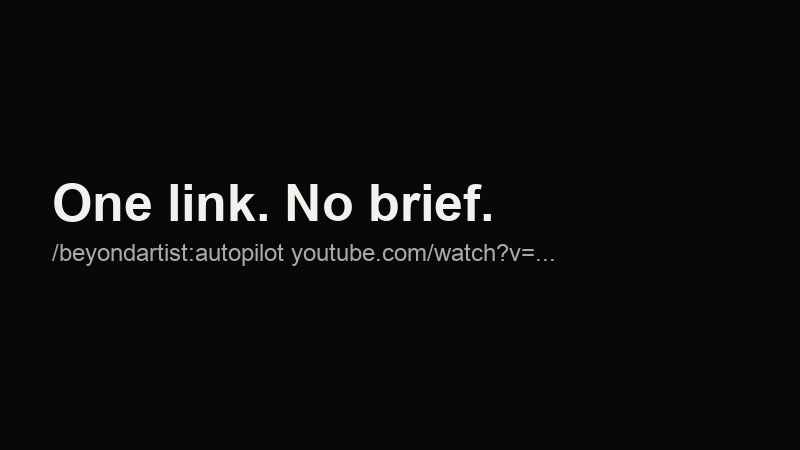

# Autopilot

Give BeyondArtist one YouTube link. It reads the video, studies the competition, makes three real concepts, tests them, repairs what fails and hands you finished files. You write no brief.

~~~text
/beyondartist:autopilot https://www.youtube.com/watch?v=VIDEO_ID
~~~

On hosts without plugin commands, say: `Use BeyondArtist Autopilot on <link>`.

## What a normal chat will not do on its own

| Step | What happens | Why it matters |
|---|---|---|
| **Reads the real job** | Title, description, chapters, captions and the current thumbnail | The promise comes from your video, not a guess |
| **Uses your taste** | Your brand, approvals and rejections from private local memory | It improves with every job and stays on your machine |
| **Feed Test** | Shows each design among real competitor thumbnails, at phone, desktop and sidebar size, in dark and light | You see the design where people will, with the duration overlay on it |
| **Quality Gate** | Measures the finished pixels: exact words, phone-size contrast and text height, overlay collisions, focal weight, clutter and repeats of your past work | Problems are caught and repaired before you see them |
| **Real typesetting** | Sets text in real fonts over the art, including shaped Urdu, Arabic, Persian and Hindi | Avoids the garbled lettering image models often produce |
| **Delivery pack** | Upload-ready file, master, phone preview, editable HTML and checksums | Ready for you or a client |

## A real run

We ran Autopilot on a real video, [Why Your Claude Designs Look Like AI Slop](https://www.youtube.com/watch?v=Hu6SuVWP3hU).

- **What it found:** the 12 competitors mostly repeated a talking head, a Claude logo, a UI screenshot and the word "slop". The video's real argument, that AI lacks creative direction, was not being shown.
- **What it made:** three concepts: "All the same", "Nobody's directing" and "It's not Claude", a blindfolded robot painter.
- **What the Feed Test caught:** at feed size, the robot sank into the dark beside brighter thumbnails. It tightened the crop and lifted the light before delivery.
- **What the Gate reported:** REVIEW. Everything measured passed except OCR on one word, which was checked by eye and was correct.
- **What is still unknown:** whether it would earn more clicks than the current thumbnail. Only a real test with an audience can answer that.

## What it does not claim

The Gate measures the file. The Feed Test shows a private comparison. Neither predicts clicks, views or reach, and the art still gets a human-style review. Competitor thumbnails are downloaded only for your private comparison, so do not republish them.

Autopilot never uploads, posts or messages anyone. Image generation uses your own tools and may cost credits; the default budget is three images plus at most two repairs.

## What you need

| Tool | Required? | Adds |
|---|---|---|
| Python 3.9+ | Yes | The helpers |
| An image model in your assistant | No, see [no image model](no-image-model.md) | Generated artwork |
| `python3 -m pip install pillow` | Recommended | Feed Test, Gate, delivery pack |
| [yt-dlp](https://github.com/yt-dlp/yt-dlp) | Recommended | Captions and automatic competitor search |
| [tesseract](https://github.com/tesseract-ocr/tesseract) | Optional | Automatic reading of your exact words |
| Chrome or Chromium | Recommended | Real typesetting and editable files |

Anything missing is reported in the result, never faked.

## Use the helpers yourself

~~~sh
python3 skills/beyondartist/scripts/autopilot.py --help
~~~

The commands are `context`, `feed`, `gate`, `typeset` and `package`. The full agent workflow is in [references/autopilot.md](../skills/beyondartist/references/autopilot.md).
